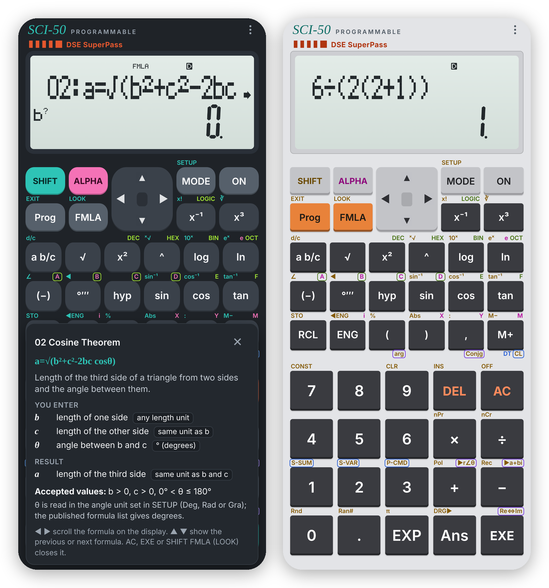

# Sci-50 programmable

**Practise your HKDSE calculator skills anywhere. Free, offline, nothing to install.**

[](https://myturtlelab.github.io/sci50-html/)
[](https://myturtlelab.github.io/sci50-html/)
[](#made-for-hkdse-students)
[](LICENSE.md)
[](https://buymeacoffee.com/flyingturtle)

A two-line programmable scientific calculator that runs in your web browser, on a phone, tablet or computer.
**Use it now:** https://myturtlelab.github.io/sci50-html/ · **Download:** [sci50.html](sci50.html) (one file, works without internet)



## What it does

Sci-50 is a calculator you can carry in your phone: the same keys, menus and two-line display as a programmable calculator for school maths, with ready-made programs and a built-in guide.

| Benefit | What it means for you |
| --- | --- |
| Almost nothing new to learn | Works key for key like several programmable calculators on the Hong Kong Examinations and Assessment Authority (HKEAA) List of Permitted Calculators: the same keys, SHIFT and ALPHA functions, menus and two-line display.<br>與香港考試及評核局（考評局）「准用計算機型號名單」上多款可編程計算機逐鍵操作相同：按鍵、SHIFT 及 ALPHA 功能、選單和兩行顯示屏都一樣。 |
| Practise before you buy | Junior secondary students can learn the keystrokes for fractions, degrees-minutes-seconds, statistics, complex numbers, base-n and programs early, before they own a calculator. |
| Ready-made programs | 93 programs in the Program Library, including the 12 DSE programs (algebra and coordinate geometry), each with a key-by-key guide for typing it into your own calculator. |
| Learn programming safely | Write and run your own keystroke programs (P1–P4) with the same memory limit as the real calculator, without touching the programs on your own calculator. |
| Works anywhere | Phone, tablet or computer, online or offline. On a computer every calculator key has a keyboard key (press ? to see them). |
| Private | No sign-up, no ads, no tracking. Your programs and settings stay in your browser. |

> Free, with no ads, no account and no subscription. If Sci-50 helps you get ready for your exams, consider buying me a coffee.
>
> <a href="https://buymeacoffee.com/flyingturtle"></a>

## Made for HKDSE students

- **Same calculator, every day.** Practise on your phone on the bus with the same key sequences you will use on paper.
- **Start early.** Students in junior forms can get used to the SHIFT and ALPHA layers, fraction keys and statistics mode before senior forms.
- **Programs explained.** Each library program shows what it does, what to enter, a worked example and the keys to type it into a real calculator.
- **Practice, not the exam room.** In the HKDSE, calculators may be used only if they are on the HKEAA [List of Permitted Calculators](https://www.hkeaa.edu.hk/DocLibrary/HKDSE/Candidate_Handbook/7_26Annex_E.pdf) and carry the "H.K.E.A.A. APPROVED" label ([Instructions to Candidates](https://www.hkeaa.edu.hk/DocLibrary/HKDSE/Candidate_Handbook/2_26Instructions_to_Candidates_E.pdf)). Sci-50 is a practice tool: it is not an examination-approved calculator and must not be used in examinations.

## Key features

- **The calculator:** a two-line display drawn dot by dot like a real LCD; calculation, complex number, base-n, statistics, regression and programming modes; 23 built-in formulas; 40 scientific constants.
- **Program Library:** 93 ready-made programs — the DSE set, everyday maths, finance, algebra, geometry, statistics, calculus, science and dates — each placed into the calculator with one tap.
- **Power Up Features (optional):** extra program banks for many more programs, a "LOOK" view that explains each built-in formula with its units, and help pages for library programs.
- **Your look:** a dark theme, and a light theme in the colours and shape of the real calculator; or a photo of your own, and a photo of the calculator's keypad becomes the keypad itself; your own calculator name and orange line.
- **Keyboard and clipboard:** on a computer, Alt+M opens the menu and ? shows the key map; Ctrl+C copies a result and Ctrl+V pastes a calculation.
- **Keeps your work:** everything is saved automatically in your browser. Backup & Restore saves your programs and settings to a file, so you can move them to another browser or device.
- **Help built in:** a User Guide with step-by-step examples, and the calculator's own display test.

## Tested against published answers

Every calculation below was keyed into the app key by key, as a person would key it, and the answer was read from what the display shows. All of them run again before each release. Results are for version 0.3.22.

Answers are judged at the precision the CASIO fx-50FH II user's guide states for this calculator type: up to 10 digits shown, 15 digits used inside, and ±1 in the 10th digit for one calculation. The other books were written for a more advanced calculator, so their answer counts as matched when, rounded to the digits this display shows, it is the same.

| <sub>Source</sub> | <sub>Cases</sub> | <sub>Used</sub> | <sub>Passed</sub> | <sub>Matches the book</sub> | <sub>Same value, shown differently</sub> | <sub>Differs for a stated reason</sub> | <sub>Failed</sub> | <sub>Not possible on this calculator type</sub> |
| --- | ---: | ---: | ---: | ---: | ---: | ---: | ---: | ---: |
| <sub>CASIO <i>fx-50FH II 用戶說明書</i> (user's guide, Traditional Chinese edition, RJA528155-001V01): every worked example and stated rule</sub> | <sub>335</sub> | <sub>335</sub> | <sub>335</sub> | <sub>321</sub> | <sub>14</sub> | <sub>0</sub> | <sub>0</sub> | <sub>0</sub> |
| <sub>CASIO Teaching Materials: <i>Real-Life Problems</i></sub> | <sub>553</sub> | <sub>354</sub> | <sub>352</sub> | <sub>340</sub> | <sub>12</sub> | <sub>2</sub> | <sub>0</sub> | <sub>199</sub> |
| <sub>CASIO Teaching Materials: <i>Chemistry Materials</i></sub> | <sub>207</sub> | <sub>134</sub> | <sub>131</sub> | <sub>126</sub> | <sub>5</sub> | <sub>3</sub> | <sub>0</sub> | <sub>73</sub> |
| <sub>CASIO Teaching Materials: <i>Physics Materials</i></sub> | <sub>168</sub> | <sub>124</sub> | <sub>115</sub> | <sub>114</sub> | <sub>1</sub> | <sub>9</sub> | <sub>0</sub> | <sub>44</sub> |
| <sub>Martin Meyer, <i>College Math by practical application</i> (InnoLearn UG, 2009)</sub> | <sub>134</sub> | <sub>82</sub> | <sub>82</sub> | <sub>72</sub> | <sub>10</sub> | <sub>0</sub> | <sub>0</sub> | <sub>52</sub> |
| <sub><b>Total</b></sub> | <sub><b>1,397</b></sub> | <sub><b>1,029</b></sub> | <sub><b>1,015</b></sub> | <sub><b>973</b></sub> | <sub><b>42</b></sub> | <sub><b>14</b></sub> | <sub><b>0</b></sub> | <sub><b>368</b></sub> |

How to read the columns:
- **Cases:** the user's guide's worked examples and stated rules, or the calculations in a book. **Used:** those this calculator type can do. **Passed** adds up the next two columns.
- **Matches the book:** the display shows the printed answer at this calculator type's precision. That includes the book's number rounded to the 10 digits this display shows (76 cases) and one answer within ±1 in the 10th digit, the accuracy the user's guide states for one calculation. For the user's guide the whole screen is compared: upper line, lower line, labels and indicators; 29 of its 321 are rules the guide states without a printed answer (input ranges, limits, example programs), and each is followed. For the other books this column includes 116 calculations keyed another way, because the book's key does not exist on this calculator type: for example, a table value worked out as f(x) with x stored in X.
- **Same value, shown differently:** the value is right; only the display differs. In the books, a decimal where the book shows a fraction, a surd or a multiple of π (28). In the user's guide (14): two statistics labels read xσn and xσn−1 where the guide writes σx and Sx, by design; eleven constant symbols draw their digit full size (C0) where the guide draws it small (C₀); and at a built-in formula's prompt the upper line keeps the formula's name where the guide leaves it empty. These last 12 are logged for a later version.
- **Differs for a stated reason:** every one follows from this calculator type's own specification, as its user's guide gives it. 12 use scientific constants: this calculator type holds the CODATA 2010 values, the books' calculator newer ones, so the last digits differ. 2 are binary numbers outside this calculator type's binary range of −512 to 511, so Sci-50 shows Math ERROR.
- **Not possible on this calculator type:** the equation solver, vectors, matrices, probability distributions, Σ, integrals and derivatives, the spreadsheet, unit conversion and other features this calculator type does not have.

More references are still being checked. They will be added here when every case is settled.

Sources: the CASIO fx-50FH II user's guide, Traditional Chinese edition (RJA528155-001V01); [CASIO Teaching Materials](https://www.casio.com/intl/scientific-calculators/teaching-materials/) (*Real-Life Problems*) and [Physics and Chemistry Materials](https://www.casio.com/intl/scientific-calculators/essential-materials/), free from CASIO; Martin Meyer, *College Math by practical application*, InnoLearn UG, 2009. These guides and books were used only as a source of test calculations and their published answers; nothing from them is in the app or in this repository. Sci-50 is not affiliated with, endorsed by or sponsored by CASIO Computer Co., Ltd., InnoLearn UG or the author. CASIO, fx-50FH II and the titles of the CASIO Teaching Materials are trademarks or titles of CASIO Computer Co., Ltd.

## Use it

**Option 1 — on the website (recommended for phones and tablets)**
1. Open https://myturtlelab.github.io/sci50-html/.
2. To keep it as an app: on iPhone or iPad, tap Share → **Add to Home Screen**; on Android or a computer, choose **Install app** (or **Add to Home screen**) in the browser menu. It then opens in its own window and works without internet.

**Option 2 — download the file (computers and Android phones)**
1. Download [sci50.html](sci50.html) and save it anywhere.
2. Open it in your browser: on a computer, double-click it; on an Android phone, tap it in your Files or Downloads app and choose your browser. No internet or installation needed.
3. Optional check that the file is genuine — compare its SHA-256 fingerprint with [sci50.html.sha256](sci50.html.sha256):
   - Windows (Command Prompt or PowerShell): `certutil -hashfile sci50.html SHA256`
   - macOS / Linux: `shasum -a 256 sci50.html`

   SHA-256 of 0.3.22: `ef89ac86f99d7a13e61106adb0ed987adf5549a953c7721b422e1d7a5ad06e51`

## First steps

1. Read the short notice and tap **OK**.
2. Type a calculation and press **EXE** (or Enter on a keyboard).
3. Tap **⋮** (top right) for the menu: **Program Library** to add a program, **Theme** to change the look, **User Guide** for help.
4. Before you clear your browser or change device, use **Menu → Backup & Restore → Export backup**.

## Update and remove

- **Update:** the website copy updates itself. After a new version is published, open the app once while online, then close and reopen it. For the downloaded file, download the new `sci50.html`.
- **Remove:** delete the installed app (or the downloaded file). To remove saved programs and settings too, clear this site's data in your browser settings — export a backup first if you want to keep them.

## Troubleshooting

| What you see | What to do |
| --- | --- |
| "Sci-50 is already open in another tab or window. Changes made here are not saved." | Only one copy saves at a time. Close the other tab or window, then reload this one. |
| My programs and settings are gone | Browsing data was cleared, or a private window was used. Restore your last backup: Menu → Backup & Restore → Import backup. |
| "The clipboard could not be read." | Your browser blocked clipboard access. Allow it when the browser asks, or press Ctrl+V (⌘V) on a keyboard. |
| The display is blank | The calculator is switched off (SHIFT AC). Press **ON**. |

## How it is built (overview)

The whole app is one HTML page. Its parts, from the outside in:

```text
sci50.html  (one self-contained file, about 0.7 MB)
│
├── <head>  (set-up)
│    ├── <meta> character set and viewport: fits phones and computers
│    ├── <meta> Content-Security-Policy: no network connection is allowed
│    ├── <title>, app icon (the website adds the app manifest)
│    └── <style> every style and theme, minified
│
├── <body>  (what you see)
│    └── div#app
│         ├── div#calc  (the calculator)
│         │    ├── header: calculator name, ? program help, ⋮ menu
│         │    ├── div#banner: the orange line
│         │    ├── div#face: the faceplate (a theme, or your own photo)
│         │    │    ├── canvas#lcd: the two-line display, drawn dot by dot
│         │    │    └── div#keypad: 50 keys with their SHIFT and ALPHA labels
│         │    └── section#look-card: formula explanation (LOOK)
│         ├── div#sheet: menu pages (Program Library, Theme, Settings,
│         │              Backup & Restore, User Guide, About)
│         └── div#toast: short messages
│
└── <script>  (one bundled script, minified)
     ├── Calculator engine: keys in, display state out
     │    ├── modes COMP, CMPLX, BASE, SD, REG and PRGM
     │    ├── expression reader, 15-digit arithmetic, display formats
     │    ├── 23 built-in formulas, 40 constants, statistics
     │    └── program editor and runner: 4 areas sharing 680 bytes
     ├── Display: 16 dot-matrix characters above, 10 digits below
     ├── Keypad and faceplate: key layout, themes, your own photo
     ├── App shell: menus, Program Library (93 programs), User Guide,
     │              Power Up Features, settings
     ├── Storage: settings and programs in the browser's local storage,
     │            your photo in IndexedDB, backups to a .json file
     └── Web layer: computer keyboard, clipboard, one copy open at a time

Website only:  manifest.webmanifest (install), sw.js (offline cache), icons/
```

- **One engine for every platform.** The same calculator engine runs the Sci-50 Android app and this web version. It has no screen, storage or network code: it only turns key presses into display states, so it behaves the same on every device and can be tested on its own.
- **The screen shows only what the engine reports.** The display and keypad draw each state the engine gives them and add nothing of their own, so what you see is what the tests checked.
- **One file.** The build packs the engine, the display, the app and the Program Library into a single HTML file. Nothing else is downloaded when it runs.
- **Private by design.** A strict security policy inside the file blocks every network connection. Your settings, programs and photos stay in your browser; the app has no server.
- **Offline website.** This site adds an app manifest and a small offline cache, so the installed app opens without internet.
- **Checked before release.** This release passed automated tests of the calculator, the display, the backups and the web version in a real browser, and the book checks [above](#tested-against-published-answers).

## Privacy

The calculator collects no personal data and makes no network connections. Your data stays in your browser on your device. This website is served by GitHub Pages, which logs visitors' IP addresses for security under the GitHub Privacy Statement. The full privacy policy is in the app: **Menu → About → Privacy policy**.

## Support the project

Sci-50 is made by one developer in spare time and will stay free: no ads, no account and no data collection. If it helps you, a coffee says thanks and pays for time on new features and fixes.

<p align="center">
  <a href="https://buymeacoffee.com/flyingturtle"></a>
  <br>
  <a href="https://buymeacoffee.com/flyingturtle">buymeacoffee.com/flyingturtle</a>
</p>

**Other ways to help, at no cost**
- ⭐ Star this repository.
- Share it with classmates, teachers and parents.
- Report a problem or suggest an idea in **Issues** on this page, or through Menu → About in the app.

## Disclaimer

Sci-50 is provided free of charge and "as is", without warranty of any kind. Check any result that matters by another method. It is not an examination-approved calculator, and it is not affiliated with or endorsed by any calculator maker or by the Hong Kong Examinations and Assessment Authority (HKEAA). HKDSE and HKEAA are named only to describe what the app is for.

## Licence

Copyright © 2026 Neo Time Consulting, Hong Kong. All rights reserved. Free to use; see [LICENSE.md](LICENSE.md) and [THIRD-PARTY-NOTICES.md](THIRD-PARTY-NOTICES.md).
This repository holds only the published web app. Website: https://cal50.4u.hk
